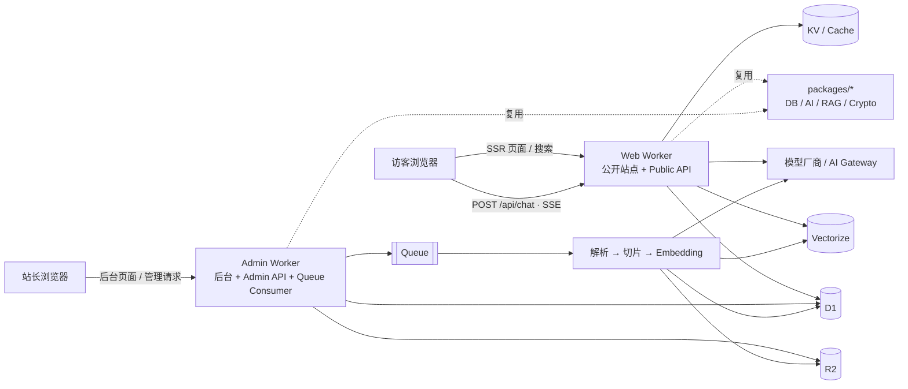

# ai-bunshin

开源、单人自托管的 AI 个人分身项目

可以基于你的简历、文章与博客创建。

访客可以浏览公开简历、项目、文章、分类、标签与归档，并通过 RAG 与站长的“个人分身 Agent”对话。站长通过独立后台维护内容、上传 PDF/Markdown/TXT、执行解析与向量化、配置任意模型厂商，并通过 ECharts 查看调用量、Token、费用、延迟和 RAG 指标。

> 维护规则：任何产品范围、项目结构、Cloudflare 资源、部署流程、环境变量、公开路由或安全方案的变更，都必须在同一个变更中同步更新本 README。

## 产品边界

- 单站长，不做组织、多租户、访客账号、充值或支付。
- 访客端没有用户概念，公开内容无需登录。
- 后台只有一个管理员，支持密码登录与可选 TOTP MFA。
- 未配置模型时，简历和博客仍可完整运行，Agent 入口自动隐藏。
- UI 参考 [Ajie’s 思源地](https://shijayhuo.github.io/) 的信息架构，以 clean-room 方式独立实现，不复制个人内容和受保护素材。

## 总体架构

项目只有两个部署应用，API 内聚在各自 Worker 中，不创建第三个 `apps/api`：



### API 位置

`apps/web` 提供：

- `GET /`、`/articles/:slug`、`/categories/*`、`/tags/*`、`/archives`
- `GET /api/search`
- `GET /api/public-config`
- `POST /api/chat`，SSE 流式回答
- `/sitemap.xml`、`/robots.txt`、`/feed.xml`、`/llms.txt`
- 文章、分类、归档、关于页均直接读取 D1；不使用前端演示数据

`apps/admin` 提供：

- `/api/admin/auth/*`
- `/api/admin/profile/*`
- `/api/admin/articles/*`
- `/api/admin/categories/*`
- `/api/admin/documents/*`
- `/api/admin/providers/*`
- `/api/admin/analytics/*`
- Queue 消费者：解析、切片、Embedding、重建索引

后台使用可刷新、支持浏览器前进/后退的 Hash 路由：`#/profile`、`#/articles`、`#/knowledge`、`#/agent`、`#/providers`。切换模块时若个人资料尚未保存会先提示确认。

共享包不是服务，不监听端口，也不发生内部 HTTP 调用。

## Monorepo 结构

```text
ai-bunshin/
├── apps/
│   ├── web/                 # 公开 SSR 站点与 Public Worker API
│   └── admin/               # 后台、Admin Worker API、Queue Consumer
├── packages/
│   ├── ai/                  # 模型渠道适配、Usage 归一化
│   ├── crypto/              # API Key 信封加密
│   ├── db/                  # D1 schema、查询与迁移
│   ├── domain/              # 共享领域类型
│   ├── rag/                 # 解析、切片、检索与引用
│   └── validation/          # API 与配置校验
├── infra/cloudflare/        # Cloudflare 初始化与迁移脚本
├── docs/                    # PRD 与详细技术设计
├── package.json
├── pnpm-workspace.yaml
└── turbo.json
```

详细设计见 [docs/README.md](./docs/README.md)。

## 核心技术

- TypeScript、pnpm Workspace、Turborepo
- Hono Worker SSR（访客端）
- React + Vite（后台）
- Tailwind 风格的项目内设计令牌与 CSS
- ECharts
- Cloudflare Workers Static Assets
- D1、R2、Vectorize、Queues、KV
- Zod、Drizzle ORM
- Vitest、Playwright

## 数据流

### 访客问答

```text
问题 → 限流/安全检查 → Query Embedding → Vectorize 召回
→ D1 回查正文与可见性 → 组装引用 → Chat 模型 → SSE
→ 写入匿名用量事件
```

Agent 只有在“渠道测试成功 + 至少一份非私有资料完成索引 + 后台开关开启”时进入运行状态。匿名访客默认每天最多成功问答 25 次、每分钟 5 次，全站默认每天 500 次；三项都可在“Agent 设置”修改。计数以服务端 D1 为准，失败、无检索结果或模型中断不会消耗每日额度。浏览器仅保存随机访客 ID，D1 只保存该 ID 与 IP 组合后的加盐哈希，不保存原始 IP。

### 文档导入

```text
上传 PDF/Markdown/TXT → R2 → Queue → 解析 → 人工可修正文本
→ 语义切片 → Embedding → Vectorize → D1 更新状态
```

MVP 仅保证文本型 PDF。扫描 PDF 会标记为“需要 OCR”，不会生成空索引。

### 内容发布与索引生命周期

- “公开展示个人资料”与“允许 Agent 使用个人资料”是两个独立开关：前者控制公开页面，后者控制生成资料是否进入 RAG。
- 个人资料每次保存前自动写入 `profile_versions`，后台可以载入历史快照后再次保存。
- 文章以 D1 为正文真源；发布且开启 Agent 检索时生成 R2 Markdown 文档并进入 Queue，修改会重建索引，归档或删除会同步移除旧向量。
- 上传新简历时，上一份简历保留为历史附件，但立即标记为私有归档并清理旧向量，避免新旧经历同时召回。
- 知识库支持 PDF、Markdown、TXT 和直接文字录入，并可修改分类/可见性、下载、重试或删除。`private` 文档不参与检索，`rag_only` 仅供 Agent，`public` 可作为公开引用来源。
- 文件原名、文件大小、用途、来源 URL 和归档时间记录在 D1；原文件仍保存在私有 R2。

## 安全

- 所有流量仅使用 HTTPS。
- D1/R2 采用 Cloudflare 静态加密；Provider API Key 再使用 AES-256-GCM 应用层加密。
- `MASTER_ENCRYPTION_KEY` 只放 Worker Secret。
- 管理员密码使用强密码哈希，Session Cookie 使用 `Secure`、`HttpOnly`、`SameSite=Strict`。
- 后台写请求执行 Origin/CSRF 校验。
- 日志不记录 API Key、Cookie、Authorization、完整 prompt 或私密原文。
- 访客 IP 仅与随机访客 ID、服务端 Secret 组合生成匿名 SHA-256 哈希，用于限流和统计。
- 自定义模型 Base URL 仅允许 HTTPS 或本地开发地址。

## GEO 与 SEO

- 公开内容由 Worker SSR 输出，主体不依赖 JavaScript。
- 每页提供 title、description、canonical、Open Graph。
- 使用 `Person`、`WebSite`、`Article`、`BreadcrumbList` JSON-LD。
- 提供 Sitemap、robots.txt、RSS 和 llms.txt。
- 文章、简历与项目使用稳定 URL、明确作者、日期和可验证来源。
- 后台、草稿、预览和搜索结果设置 `noindex`。
- `llms-full.txt` 默认关闭，开启后也只包含公开内容。
- 页面 title、description、canonical、作者信息、`Person`、`WebSite`、`Article` 和面包屑 JSON-LD 均由 D1 中的当前资料动态生成。
- Sitemap、RSS 和 `llms.txt` 自动包含已发布文章与分类；草稿、归档和私有知识不会被输出。

## 本地开发

本地开发采用两个进程、一个共享数据目录：`apps/admin` 由 Cloudflare Vite 插件同时提供 React 管理界面和 Admin Worker API；`apps/web` 提供访客端和公开 Chat API。两者共享 `apps/admin/.wrangler/state` 中的本地 D1 数据，因此后台上传的内容可以立即被访客端检索，无需额外启动第三个 API 项目。

首次打开后台时会进入站长账号初始化页。密码至少 12 位；初始化完成后使用 HttpOnly 会话 Cookie 登录。模型 API Key 输入框始终使用密码态，只显示首尾掩码和字符长度；服务端只返回 `key_preview`，密文使用 AES-256-GCM 保存，任何读取接口都不会返回原始 Key。

### 前置条件

- Node.js 22+
- pnpm 10+
- Cloudflare 账号仅在远程预览或部署时需要

### 安装

```bash
git clone <your-repository-url> ai-bunshin
cd ai-bunshin
pnpm install
cp .dev.vars.example .dev.vars
pnpm db:migrate:local
pnpm dev
```

本地地址：

- 访客端：`http://localhost:8787`
- 后台：`http://localhost:8788`

知识库流程为：上传文本型 PDF/TXT/Markdown → R2 存储 → Queue 消费 → PDF 文字提取 → 切片 → D1 向量索引 → 访客端相似度检索。未配置模型渠道时，Chat 会直接展示带来源的检索结果；配置 OpenAI-compatible 渠道后，会将检索上下文交给模型生成回答。扫描版 PDF 无可提取文字时会标记为 `needs_ocr`，需要先进行 OCR。

### 首次初始化

```bash
pnpm admin:init
```

随后进入后台完成：

1. 设置个人资料和公开域名。
2. 配置 Chat 与 Embedding 渠道。
3. 上传简历和知识文档。
4. 测试检索并发布站点。

## 环境变量与 Secrets

本地变量参考 `.dev.vars.example`。生产环境必须通过 Wrangler Secret 设置：

```bash
wrangler secret put MASTER_ENCRYPTION_KEY
wrangler secret put SESSION_SECRET
wrangler secret put ADMIN_BOOTSTRAP_TOKEN
```

模型 API Key 由后台录入，经 `MASTER_ENCRYPTION_KEY` 加密后保存，不需要逐个写入 Wrangler。

### 个人版最简配置

后台内置 OpenAI、DeepSeek、OpenRouter 与自定义 OpenAI-compatible 预设。普通使用只需选择厂商并输入一个 API Key；Base URL、推荐 Chat 模型和向量策略由系统自动选择。DeepSeek/OpenRouter 默认使用本地隐私向量，不会把简历发送给第三方 Embedding 服务。OpenAI 可选择外部 Embedding，但必须由站长显式勾选数据外传授权。

“测试并启用”会先调用推荐聊天模型验证 Key，测试失败不保存；测试成功后加密保存并设为默认渠道。已有渠道可使用“重新测试连接”恢复健康状态。个人资料发布后会生成一份内部 Markdown 文档并自动进入 Queue；上传简历或知识资料后同样自动解析、切片和索引。后台“Agent 设置”统一展示渠道健康、知识库就绪数量、今日问答和向量方案。

如果 OpenAI 返回 `Missing scopes: model.request`，说明 Key 本身已被识别，但没有模型推理权限。请到对应 Project 的 API Keys 页面把 Key 设置为 `All`，或在 `Restricted` 权限中开启模型请求，并确认账号在该 Project 中是 Member 或 Owner。模型渠道表单使用右侧抽屉，Key 在输入和保存后都只显示固定五颗星及首尾字符。

个人资料的结构化字段和 Markdown 原文保存在 D1，简历、头像等原始文件保存在私有 R2。后台“个人资料”按基本信息、关于我、经历与项目、简历附件、版本记录分区；支持 Markdown 实时预览、技能去重、动态社交链接、工作经历/项目/教育、头像焦点位置调整，以及公开展示和 Agent 使用两个独立开关。必填项统一使用红色星号标识。头像区域可直接点击上传、替换或恢复名称首字 SVG。简历上传展示浏览器上传进度和后续索引状态，可下载、重试、删除并查看历史版本。保存后主站侧边栏、关于页、SEO 和 Agent 读取同一份数据。头像和附件都通过 Worker 受控输出，不公开 R2 Bucket。文本型 PDF/TXT/Markdown 经 Queue 异步解析；本地隐私模式使用 D1 向量回退，显式授权外部 Embedding 后使用版本化 Vectorize 索引。切换模型应新建索引版本并重建，不能把不同维度混入同一索引。

文章管理已经接入 D1：后台支持 Markdown 编辑/预览、草稿/发布/归档、分类、SEO 描述和独立的 Agent 检索开关；公开端的文章列表、详情、分类计数和归档全部读取真实数据。公开 Markdown 使用白名单式安全渲染，支持标题、段落、列表、引用、链接、行内代码和代码块。Agent 的流式回答也会按段落和列表排版，并把 `[1]` 等引用显示为可辨识角标，公开文章来源可以点击回到原文。

公开站点首页就是“问问分身”RAG 对话页，并默认选中该一级菜单；文章、分类、归档和关于均使用独立 URL，切换左侧目录时右侧会真正进入对应页面。移动端侧栏在点击内容空白区或选择导航后自动收起，导航图标统一使用同一套 20px 描边 SVG。联想问题点击后立即发起问答，输入框按 Enter 发送、Shift+Enter 换行。公开标题会在读取个人资料后更新为“页面名称 · 显示名称-AI分身”，首页显示为“显示名称-AI分身”。

公开站点采用三档响应式导航：`>=1200px` 使用顶部导航释放正文宽度，`981–1199px` 保留紧凑左侧导航，`<=980px` 使用可收起抽屉。站内文章、分类、归档和关于页面由浏览器拦截同源链接并局部替换主内容，同时更新 History、canonical、Open Graph 和 JSON-LD；直接访问任意 URL 仍由 Worker 服务端渲染，SEO 与无 JavaScript 访问不受影响。Agent 参考资料只有在文档提供公开 `source_url` 时才显示“访问原文章”，文章来源会进入 `/articles/:slug`。后台在 `<=820px` 改为顶部工具栏与下拉导航抽屉，避免窄屏侧栏挤压表单；静态资源使用显式版本号，公开页内置最小关键布局样式作为加载延迟兜底。

Agent 的核心身份由服务端固定：它始终是资料所有者本人的 AI 分身，使用第一人称描述资料中的经历、项目、观点和文章；后台“附加系统要求”不能覆盖该身份。公开问答仍受后台启用开关、健康模型渠道、已索引知识库和服务端额度共同控制。

后台用量页和 ECharts 从 `usage_events` 读取真实 Chat/Embedding 请求、Token、延迟与状态。费用只有在渠道价格可确定时才是估算值；它不等同于厂商账户真实余额。

## Cloudflare 资源初始化

正式部署需要：

- 两个 Workers：`ai-bunshin-web`、`ai-bunshin-admin`
- 一个 D1：`ai-bunshin`
- 一个 R2：`ai-bunshin-assets`
- 一个 Vectorize：`ai-bunshin-knowledge-v1`
- 一个 Queue 和一个 DLQ
- 一个 KV namespace

登录后执行：

```bash
pnpm cf:login
pnpm cf:setup
```

当前仓库已提供生产发布门禁。首次启用 R2 并完成资源配置后，执行：

```bash
pnpm deploy:production
```

脚本会依次检查 Cloudflare 登录和 R2、运行类型检查/测试/构建、应用远程 D1 迁移、部署两个 Worker、生成并安装生产 Secrets，最后输出一次性管理员初始化令牌。稳定密钥保存在本机被 Git 忽略的 `.deploy-secrets.json` 中；后续部署会复用，避免更换主密钥导致已保存的模型 API Key 无法解密。

将命令返回的资源 ID 写入两个应用的 `wrangler.jsonc`，然后：

```bash
pnpm db:migrate:remote
pnpm deploy
```

建议域名：

- `example.com` → `ai-bunshin-web`
- `admin.example.com` → `ai-bunshin-admin`

## CI/CD

```text
Pull Request
→ lint + typecheck + test
→ build 两个应用
→ preview deploy
→ smoke tests
→ merge main
→ D1 向前兼容迁移
→ deploy admin
→ deploy web
```

生产迁移采用 expand/contract，不能在同一次发布中先删除旧字段。

## 常用命令

```bash
pnpm dev
pnpm build
pnpm lint
pnpm typecheck
pnpm test
pnpm db:migrate:local
pnpm db:migrate:remote
pnpm deploy
```

## 开源部署注意事项

1. 不提交 `.dev.vars`、Cloudflare Token、真实 API Key 或数据库导出。
2. Fork 后修改站点名称、canonical origin 和管理员邮箱。
3. Embedding 模型或维度变更时新建版本化 Vectorize 索引，重建完成后再切换。
4. 厂商不提供余额 API 时，后台显示的是“本地预算剩余”，不是厂商真实余额。
5. 上线前配置预算、访客限流，并按需开启 Turnstile。

## 当前状态

访客端与管理后台均已部署到 Cloudflare Workers。已打通个人资料与简历上传、R2 原文件、Queue 解析、D1/Vectorize 检索、单 Key 渠道测试、流式 Agent 问答、引用展示、匿名 25 次限流和真实用量记录。扫描版 PDF 仍需站长先做 OCR；多管理员、组织和充值计费不属于个人版范围。

## License

Apache-2.0。第三方依赖继续遵循其各自许可证。
