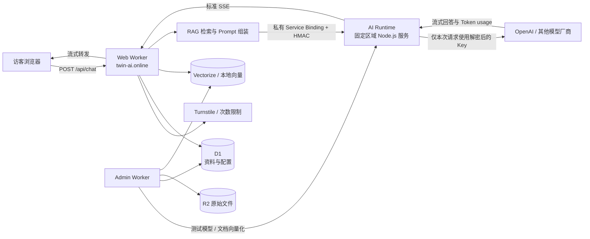

# Bunshin 固定区域 AI Runtime 技术方案

> 文档状态：代码与 Cloudflare Container/Service Binding 部署定义已实现；当前账户尚未开通 Workers Paid，生产 Runtime 待计划升级后部署
> 适用版本：ai-bunshin 0.1.x  
> 更新日期：2026-11-27

## 1. 背景与目标

Bunshin 的公开页面、内容后台、RAG 数据和限流均运行在 Cloudflare。原始实现由 Web Worker 或 Admin Worker 直接请求模型厂商。该模式部署简单，但全球边缘执行位置不等于一个可预测的固定上游出口；当模型厂商对请求区域、账号、Project 权限或网络路径有限制时，访客能够打开门户并不代表模型生成链路一定可用。

本方案增加一个固定区域的 AI Runtime，把模型执行从业务 Worker 中抽离，同时保持以下公开契约不变：

- 访客仍然只访问 `POST https://twin-ai.online/api/chat`。
- 浏览器永远不接收模型 API Key。
- D1、R2、Vectorize、Queue 和公开路由不迁移。
- Turnstile、访客限流、RAG 相关性门控、引用、预算和用量统计仍由现有 Worker 控制。
- Runtime 不成为开放代理，不接受浏览器跨域调用。
- 未配置 Runtime 时可以回退到原有加密 Key 直连链路。

## 2. 方案结论

新增 `apps/runtime`，作为第三个部署单元，但不是第三套用户产品。它只执行三类内部请求：

1. Chat Completion 流式生成。
2. Query/Document Embedding。
3. 模型渠道连接测试。

业务状态继续由 Web/Admin Worker 持有。Runtime 无权读取 D1、R2、Vectorize、管理员 Session 或访客 Cookie。



## 3. 职责边界

### 3.1 Web Worker

- 保持 `/api/chat` 的唯一公开入口。
- 校验请求、Turnstile 和每日/每分钟/全站额度。
- 从 D1 和 Vectorize 执行混合检索。
- 做相关性门控、融合、重排和引用候选编号。
- 组装“本人 AI 分身”系统 Prompt。
- 用 HMAC 调用 Runtime 并转发 SSE。
- 把 Token、费用估算、延迟、状态和匿名访客哈希写入 D1。
- Runtime 不可用时释放已预留额度，并返回脱敏错误。

### 3.2 Admin Worker

- 管理文章、知识库、渠道元数据和预算。
- 解析 PDF/Markdown/TXT、切片并写入本地向量。
- 经站长明确授权后，通过 Runtime 生成外部 Embedding。
- 通过 Runtime 执行渠道健康检查。
- 继续记录 Queue 状态、Embedding 用量和审计事件。

### 3.3 AI Runtime

- 根据受控 provider ID 选择固定厂商地址，并仅在当前请求生命周期使用调用方传入的 API Key。
- 将统一 Chat/Embedding 请求转换为 OpenAI-compatible 请求。
- 原样流式转发厂商 SSE，并保留 usage 事件。
- 统一清洗上游错误，绝不输出密钥。
- 校验内部 HMAC、时间窗和请求 ID，拒绝重放。
- 对请求体、消息数、单条长度和 Embedding 批量数设上限。

### 3.4 明确不属于 Runtime 的能力

- 不读取或写入 D1。
- 不读取 R2 原文件。
- 不查询 Vectorize。
- 不做访客认证、Turnstile 或 25 次额度。
- 不提供后台 UI。
- 不接受任意目标 URL 或任意请求头。
- 不保存 Prompt、回答或知识原文。

## 4. 内部 API 契约

### 4.1 Chat

`POST /internal/v1/chat`

```json
{
  "provider": "openai",
  "model": "gpt-5.4-mini",
  "apiKey": "仅在私有内部请求中传输，日志与响应禁止记录",
  "messages": [
    { "role": "system", "content": "RAG Prompt" },
    { "role": "user", "content": "问题" }
  ]
}
```

成功响应为上游兼容的 `text/event-stream`。Web Worker 继续解析 `choices[].delta.content` 与 `usage`，再转换成门户既有 SSE 事件，因此前端无需改协议。

### 4.2 Embedding

`POST /internal/v1/embeddings`

```json
{
  "provider": "openai",
  "model": "text-embedding-3-small",
  "input": ["第一段文本", "第二段文本"]
}
```

响应：

```json
{
  "vectors": [[0.01, 0.02]],
  "usage": {
    "inputTokens": 12,
    "outputTokens": 0,
    "cachedTokens": 0,
    "estimated": false
  }
}
```

### 4.3 渠道测试

`POST /internal/v1/providers/test`

请求包含 provider、model、受控 Base URL 和当前后台待验证的 API Key。Runtime 发起最小测试请求，成功返回 `{ "ok": true }`。连接测试与门户问答因此验证同一份凭据和同一执行出口。

### 4.4 健康检查

`GET /health` 只返回进程存活信息，不返回已配置厂商、密钥状态或内部环境变量。

## 5. 内部鉴权

每个 Worker 请求携带：

```text
X-Bunshin-Timestamp
X-Bunshin-Request-Id
X-Bunshin-Signature
```

签名载荷：

```text
METHOD\nPATH\nTIMESTAMP\nREQUEST_ID\nBASE64URL(SHA256(BODY))
```

签名算法：

```text
BASE64URL(HMAC-SHA256(AI_RUNTIME_AUTH_SECRET, payload))
```

Runtime 的验证规则：

- Secret 至少 32 个字符。
- 时间戳与服务器时间偏差不得超过 5 分钟。
- Request ID 在 5 分钟内只能使用一次。
- 使用常量时间比较签名。
- 请求体超过 2 MiB 立即拒绝。
- 不配置 CORS，不接受浏览器凭据。

生产通过 HTTP Service Binding 调用 Runtime，并关闭 `workers.dev` 公网入口；Service Binding 是第一道账户级权限边界，HMAC 是第二道应用层完整性校验。完整 JSON（包括临时明文 API Key）都参与 body hash 和签名。

## 6. Provider 和 Secret 模型

Runtime 只接受以下 provider ID。预设地址由 Runtime 固定，不信任调用方随意指定的 Origin：

| Provider ID | 默认 Base URL | Key 来源 |
|---|---|---|
| `openai` | `https://api.openai.com/v1` | 后台录入并在 D1 信封加密保存 |
| `deepseek` | `https://api.deepseek.com/v1` | 后台录入并在 D1 信封加密保存 |
| `openrouter` | `https://openrouter.ai/api/v1` | 后台录入并在 D1 信封加密保存 |
| `custom` | 必须出现在允许列表 | 后台录入并在 D1 信封加密保存 |

预设厂商忽略调用方传入的 Base URL，防止将 Runtime 变成任意 URL 代理。自定义渠道必须使用 HTTPS，并且规范化后的完整 Base URL（包括路径，不含查询和片段）必须精确出现在 `AI_RUNTIME_CUSTOM_BASE_URLS` 中。

后台始终要求站长输入自己的 API Key。Key 使用 `MASTER_ENCRYPTION_KEY` 加密保存，列表只返回短掩码；Web/Admin 在调用 Runtime 前临时解密，通过私有绑定传递，Runtime 不写数据库、磁盘、环境变量或日志。

Runtime 默认拒绝没有携带请求级 Key 的模型调用，避免静默改用另一个账户并错误标记 D1 凭据有效。仅迁移旧部署时可临时设置 `AI_RUNTIME_ALLOW_ENV_PROVIDER_KEYS=true` 使用环境变量 Key；新部署和正常生产必须保持 `false`。

## 7. RAG 完整链路

### 7.1 提问

```text
浏览器问题
→ Web Worker Turnstile/限流
→ BM25 + 本地向量或 Runtime Query Embedding
→ RRF 融合与重排
→ 相关性阈值
→ Prompt 与来源编号
→ Runtime Chat
→ 模型 SSE
→ Web Worker 规范化 SSE
→ 浏览器
```

### 7.2 文档入库

```text
后台上传
→ R2
→ Admin Queue Consumer
→ 解析/切片
→ D1 本地向量（始终生成）
→ Runtime Document Embedding（仅显式授权）
→ Vectorize
→ 文档 indexed
```

Chat 和 Embedding 必须一起迁移。只迁移 Chat 会留下 Query Embedding 或 Document Embedding 的旧出口，造成“回答服务正常但检索或入库失败”的半可用状态。

## 8. 兼容、灰度与回滚

Worker 只有在以下条件全部满足时启用 Runtime：

```text
AI_RUNTIME Service Binding 或兼容 AI_RUNTIME_URL 存在
AI_RUNTIME_AUTH_SECRET 非空
AI_RUNTIME_ENABLED != false
```

否则继续使用现有 D1 加密 Key 和 Provider Adapter。该行为用于部署迁移和紧急回滚，不建议长期同时维护两套生产密钥。

灰度顺序：

1. 升级 Workers Paid，部署 Runtime，但暂不部署 Web/Admin 的 Service Binding 配置。
2. 为 Runtime 配置 HMAC Secret，并通过内部验收脚本检查健康状态。
3. 使用签名脚本测试 Chat、Embedding 和渠道测试。
4. 给 Admin Worker 配置同一个 Secret 并部署 Service Binding，验证渠道测试和一份测试文档入库。
5. 给 Web Worker 配置同一个 Secret并部署 Service Binding，执行门户问答。
6. 观察模型错误率、P95 延迟、Token 和检索命中率。
7. 稳定后删除 D1 中不再使用的旧 Key，或保留加密记录但禁止回退。

紧急回滚只需把两个 Worker 的 `AI_RUNTIME_ENABLED` 设为 `false` 并重新部署；门户和后台数据不需要回滚。

## 9. 故障与降级

| 故障 | 行为 |
|---|---|
| Runtime DNS/连接失败 | 释放本次额度，记录 `chat_provider_error`，返回脱敏提示 |
| Chat 流中断 | 释放额度，记录 `chat_stream_interrupted` |
| Query Embedding 失败 | 当前请求失败；后续可增强为自动退回本地向量 |
| Document Embedding 失败 | 保留本地向量、记录 fallback，文档仍完成索引；不污染 Chat 渠道状态 |
| 无相关资料 | 不调用模型，不消耗成功问答额度 |
| 模型 Key 未录入或历史占位密文 | 渠道测试失败，后台要求重新录入，不把占位值发送给厂商 |
| HMAC 失败/重放 | Runtime 返回 401，不触达模型厂商 |
| 预算用尽 | Web Worker 在调用 Runtime 前拒绝请求 |

## 10. 可观测性

业务指标继续写入 D1：

- `usage_events`：模型、场景、Token、费用估算、延迟、状态。
- `rag_query_events`：召回模式、数量、Top Score、检索耗时。
- `observability_events`：HTTP、模型错误、流中断和安全事件。
- Queue Run：解析、Embedding、重试和卡死状态。

Runtime 输出结构化日志，但只允许记录 request ID、provider ID、模型、HTTP 状态、耗时、错误类别、输入条目数量和字符总量。不得记录 API Key、Authorization、完整 Prompt、知识片段或完整回答。

## 11. 部署

### 11.1 Cloudflare Container 部署形态

仓库中的 `apps/runtime/wrangler.jsonc` 把 Node.js Runtime 打包为 Cloudflare Container，并通过 `AiRuntimeContainer` Durable Object 作为唯一入口。Container 使用 `default` 调度策略，约束到 `ENAM`/`WNAM` 且 `jurisdiction=us`，从而使模型请求从受支持的美国区域发出。Runtime Worker 关闭 `workers.dev`，仅允许 Web/Admin 的 Service Binding 调用。

Cloudflare Containers 不包含在免费计划中，需要 Workers Paid 计划。2026-11-28 对当前账户的只读预检明确返回“Deploying containers requires the Workers Paid plan”，因此升级前不能把 Web/Admin 切到 Runtime；普通 Worker Targeted Placement 已经真实请求验证，仍会收到 OpenAI 的 `unsupported_country_region_territory`，不能作为等价替代。

生产发布脚本在质量门禁和任何 Worker 上传前执行 `wrangler containers list` 只读预检。免费计划、Containers 未开通或 Wrangler 授权不足都会立即终止，并保持 D1、Admin 与 Web 不变。Cloudflare 的 Container 发布本身不是事务：Worker 代码可能先上线、镜像推送随后失败，因此不能把一次 `wrangler deploy` 的 Worker 上传当成 Runtime 已就绪；只有镜像发布、三端 Secret 同步和签名深度健康检查全部通过后，才允许 Web 切流。

Cloudflare 已把 `default` 调度标记为 deprecated，但截至 2026-11-27，新的 `durable_object` 调度仍不支持应用级区域约束。当前选择是“固定区域优先”的有意取舍；当新策略支持区域约束时，应迁移到新应用，不能直接原地修改调度策略。

Docker 构建上下文受根目录 `.dockerignore` 保护，明确排除 `.deploy-secrets.json`、`.dev.vars*`、`.env*`、`.git`、构建产物和依赖目录。禁止删除这些规则后直接构建生产镜像。

### 11.2 Runtime Secret

```bash
PORT=8080
AI_RUNTIME_AUTH_SECRET=<至少32字符随机值>
AI_RUNTIME_ALLOW_ENV_PROVIDER_KEYS=false
AI_RUNTIME_CUSTOM_BASE_URLS=https://example-provider.invalid/v1
AI_RUNTIME_REQUEST_TIMEOUT_MS=60000
```

Secret 必须逐项通过 Wrangler 写入 Runtime，不能放入 `wrangler.jsonc`：

```bash
wrangler secret put AI_RUNTIME_AUTH_SECRET --config apps/runtime/wrangler.jsonc
```

其他厂商按需写入对应 Secret。站长必须确认密钥用途、目标 Cloudflare 账号和生产环境后再执行。

### 11.3 Docker 本地验证

```bash
docker build -f apps/runtime/Dockerfile -t ai-bunshin-runtime .
docker run --rm -p 8790:8080 --env-file apps/runtime/.env ai-bunshin-runtime
```

生产部署：

```bash
pnpm --filter @ai-bunshin/runtime deploy
```

Runtime Worker 不提供公开 `workers.dev` URL。`/health` 和三个 `/internal/v1/*` 接口只可经 Service Binding 到达，内部接口没有有效签名时仍返回 401。

### 11.4 Web/Admin Secret 与切流

```bash
wrangler secret put AI_RUNTIME_AUTH_SECRET --config apps/web/wrangler.jsonc
wrangler secret put AI_RUNTIME_AUTH_SECRET --config apps/admin/wrangler.jsonc
```

Web/Admin/Runtime 三端的 `AI_RUNTIME_AUTH_SECRET` 必须完全一致。部署脚本还会给 Web/Admin 写入独立的 `DEPLOY_HEALTH_TOKEN`；只有携带该 Header 的 `?deep=1` 探针才会唤醒 Container 并执行签名协议版本检查，公开浅健康检查不会触发 Runtime。

首次发布必须遵循“开通 Paid → 部署 Runtime → 三端同源 Secret → 内部签名测试 → Admin 灰度 → Web 切流”的顺序。Runtime 未存在或 Secret 尚未同步时，不要部署带 Service Binding 的 Web/Admin 配置。

## 12. 本地验证

```bash
pnpm install
cp apps/runtime/.env.example apps/runtime/.env
pnpm --filter @ai-bunshin/runtime dev
pnpm dev
pnpm typecheck
pnpm test
pnpm build
```

验收至少覆盖：

1. 无签名请求返回 401。
2. 过期签名返回 401。
3. 重放 Request ID 返回 401。
4. 请求级 OpenAI Key 缺失时渠道测试返回 `PROVIDER_KEY_MISSING`，不会静默使用环境 Key。
5. Chat 能连续转发 SSE 和 usage。
6. Query Embedding 返回维度正确的向量。
7. 文档 Queue 能通过 Runtime 写入 Vectorize。
8. 无相关资料时不调用 Runtime。
9. Runtime 明确启用但缺失时 fail-closed，不会把 Key 回退发送到不可控出口。
10. 门户和后台不出现 Runtime URL、Key 或内部错误正文。

## 13. 安全与合规边界

固定区域 Runtime 解决的是部署出口可预测性和模型执行隔离，不应被用于绕过模型厂商地区政策。部署区域、账号主体、支付方式和最终服务范围都必须符合厂商条款。目标访客所在地区不受某厂商支持时，应在后台选择当地可合法提供服务的模型厂商。

## 14. 决策记录

选择“薄 Runtime”而不迁移完整 RAG 后端，原因如下：

- D1/Vectorize 使用 Worker 原生绑定，迁移会扩大权限和网络面。
- 相关性门控和额度应在调用模型前执行，保留在 Web Worker 成本更低。
- Runtime 无业务数据权限，泄露半径更小。
- `/api/chat` 和前端 SSE 契约不变，迁移对门户透明。
- Runtime 可以独立扩缩容、替换运行平台或增加新厂商。
- 发生故障时只切换执行层，不需要迁移或回滚内容数据。

这也是本项目在“可部署性、回滚能力、安全边界和现有功能不受影响”之间的最终折中。
