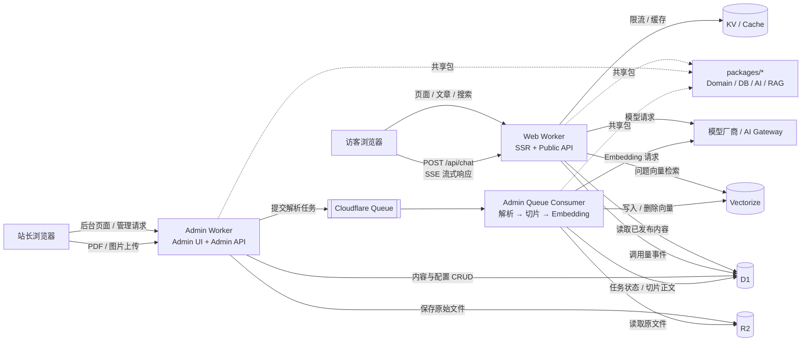

# 技术架构方案

## 1. 技术选型

| 层级 | 选型 | 原因 |
|---|---|---|
| Monorepo | pnpm workspace + Turborepo | 共享包、增量构建、部署边界清晰 |
| 语言 | TypeScript strict | Web/Worker/共享领域统一类型 |
| 访客端 | React Router SSR + Vite | SSR/SEO 友好，适配 Cloudflare Workers |
| 后台 | React + React Router + Vite | 管理端交互密集，组件生态成熟 |
| API | Hono | Worker 原生、轻量、类型友好 |
| UI | Tailwind CSS + Radix primitives | 易实现独立设计系统与无障碍组件 |
| 图表 | ECharts | 满足多维用量与成本可视化 |
| 数据库 | Cloudflare D1 + Drizzle | 单人系统数据量适合，运维成本低 |
| 文件 | Cloudflare R2 | PDF、图片和简历原文件 |
| 向量 | Cloudflare Vectorize | 与 Worker 原生绑定，支持元数据过滤 |
| 异步任务 | Cloudflare Queues | 解析、切片、Embedding 与重建索引 |
| 缓存/限流 | KV + Cache API | 公共配置缓存、访客限流和幂等短状态 |
| AI | Provider Adapter + 可选 AI Gateway | BYOK、多厂商、统一观测与降级 |
| 校验 | Zod | API、环境变量和表单共享 Schema |
| 测试 | Vitest + Playwright | 单元、契约和端到端测试 |

Cloudflare 当前建议新项目优先使用 Workers Static Assets，而非新建 Pages 项目。因此两个应用均部署为 Worker：静态资源与对应 Worker 代码作为一个版本发布。

## 2. 逻辑架构

### 2.1 API 所在位置

本项目不创建独立 `apps/api`。API 按使用者和安全边界分别内聚在两个应用的 Cloudflare Worker 中：

- `apps/web/worker`：公开只读 API、搜索和 Agent 对话流。
- `apps/admin/worker`：登录、内容管理、上传、模型配置、统计和异步任务消费者。
- `packages/*`：共享领域逻辑，不对外监听端口，也不是第三个服务。



`Web Worker` 和 `Admin Worker` 是两个独立部署单元、两个域名和两个权限边界；它们共用同一套 D1/R2/Vectorize 资源和共享包。这样保持“两个项目”的产品心智，同时避免独立 API 服务带来的第三套部署、鉴权和跨服务调用。

```text
访客
  │
  ▼
Web Worker ── SSR/Static Assets
  ├── D1：读取已发布内容
  ├── Vectorize：RAG 检索
  ├── AI Provider/AI Gateway：生成回答
  ├── KV：限流与公开配置缓存
  └── D1：写入匿名用量事件

站长
  │
  ▼
Admin Worker ── Admin Assets/API
  ├── D1：内容、配置、任务、统计
  ├── R2：原始文件与媒体
  ├── Queue：解析/切片/向量化任务
  └── Vectorize：索引写入与删除

Queue Consumer（属于 Admin Worker）
  └── R2 → Parser → Chunker → Embedding → Vectorize + D1
```

## 3. 页面渲染与缓存

### 公开端

- 首页、文章详情、分类、标签、归档、关于：SSR 输出完整 HTML。
- 带内容哈希的 JS/CSS/图片：长缓存并标记 immutable。
- 已发布内容响应使用 CDN 缓存；发布或下线后按 URL/tag 主动失效。
- Agent 对话、搜索建议等动态 API 不缓存私人请求体。
- 文章必须在无 JavaScript 时仍能读取主体内容。

### 后台

- 后台页面禁止公共缓存。
- 所有响应包含 `Cache-Control: no-store` 和 `X-Robots-Tag: noindex, nofollow`。
- 大图表仅在进入看板时懒加载 ECharts。

## 4. 内容与 RAG 管线

### 4.1 数据状态

```text
draft
→ uploaded
→ parsing
→ parsed
→ chunking
→ embedding
→ indexed

任一步骤可进入 failed，允许从失败步骤重试。
```

### 4.2 解析器

统一接口：

```ts
interface DocumentParser {
  supports(mimeType: string): boolean;
  parse(input: ArrayBuffer): Promise<ParsedDocument>;
}
```

MVP：纯文本、Markdown、TXT、文本型 PDF。扫描 PDF 返回“需要 OCR”的明确状态，不生成空索引；后台接受本地 OCR 结果并作为独立 R2 对象保留。任何把私有原文件传给第三方 OCR/多模态模型的能力都必须增加独立授权，不能因已配置聊天 Key 就默认外传。

文档和文章保留版本表。R2 保存原文件、替换版本、OCR 文本和文章封面，D1 保存元数据、状态、解析文本、版本关系与发布计划。文章定时任务由 Admin Worker Cron Trigger 每 5 分钟扫描一次，状态到期后发布并复用既有索引生命周期。

### 4.3 切片策略

- 优先按 Markdown 标题和自然段切分。
- 简历按工作经历、项目、技能等结构化条目切分。
- PDF 按标题/段落切分，保留页码。
- 建议目标 400–800 tokens，重叠 60–100 tokens。
- 切片保存 `documentId`、`categoryId`、`sourceType`、`visibility`、`language`、`page`、`headingPath` 和内容哈希。
- 内容哈希不变时跳过重复 Embedding。

### 4.4 检索与回答

MVP 流程：

```text
问题规范化
→ 安全与范围判断
→ Query Embedding
→ Vectorize TopK + visibility/category 过滤
→ 相似度阈值
→ 去重与上下文组装
→ 模型生成
→ 引用校验
→ SSE 输出
```

后续增加 D1 FTS/BM25 与向量结果的 RRF 融合、Rerank 和离线评测。

## 5. 模型渠道抽象

```ts
interface ChatProvider {
  stream(request: ChatRequest): AsyncIterable<ChatEvent>;
  test(): Promise<ProviderHealth>;
}

interface EmbeddingProvider {
  embed(texts: string[]): Promise<EmbeddingResult>;
  test(): Promise<ProviderHealth>;
}
```

模型配置保存厂商、Base URL、模型、价格和能力；API Key 加密后保存在 D1。生产环境的主加密密钥使用 Worker Secret 注入。

供应商返回 Token usage 时使用真实值；未返回时使用 tokenizer 估算，并在记录中标记 `estimated=true`。

## 6. 用量与 ECharts

### 6.1 原始事件

每次调用写入不可变 `usage_event`：

- 场景、渠道、模型。
- 输入/输出/缓存/Embedding Token。
- 费用、货币、价格快照。
- 状态、延迟、错误类型。
- 匿名访客哈希与请求 Trace ID。

### 6.2 聚合

Cron Trigger 每小时/每天把原始事件聚合到 `usage_hourly` 和 `usage_daily`。看板默认查询聚合表，点击明细时才查询原始事件。

### 6.3 图表接口

- `GET /api/admin/analytics/overview`
- `GET /api/admin/analytics/timeseries`
- `GET /api/admin/analytics/providers`
- `GET /api/admin/analytics/latency`
- `GET /api/admin/analytics/rag`

接口返回图表中立数据，不在服务端拼装 ECharts option。

## 7. 关键 API

### 公开 API

- `POST /api/chat`
- `GET /api/search`
- `GET /api/public-config`
- `GET /sitemap.xml`
- `GET /feed.xml`
- `GET /llms.txt`

### 后台 API

- `/api/admin/auth/*`
- `/api/admin/profile/*`
- `/api/admin/articles/*`
- `/api/admin/categories/*`
- `/api/admin/tags/*`
- `/api/admin/documents/*`
- `/api/admin/providers/*`
- `/api/admin/analytics/*`
- `/api/admin/settings/*`

写接口统一要求登录会话、CSRF 防护、Zod 校验和审计记录。

## 8. 可观测性

- Workers Logs 与 Traces。
- 结构化 JSON 日志。
- 所有请求生成 Trace ID。
- 日志记录错误上下文但不记录 prompt 全文、API Key 和原始私密文档。
- 解析任务记录阶段、尝试次数、错误码与下一次重试时间。
- 告警指标：模型错误率、Queue 死信、索引失败、异常 Token 峰值和登录失败。

## 9. 技术风险

| 风险 | 对策 |
|---|---|
| PDF 库在 Workers 兼容性有限 | Parser Adapter；MVP 限文本型 PDF；大型文档异步处理 |
| Provider 用量字段不统一 | 统一 Usage normalizer；缺失时估算并标注 |
| 厂商通常不提供余额 API | 分开显示“厂商余额”和“本地预算剩余” |
| Vectorize 模型维度变更 | 新建版本化索引，完成迁移后切换，不原地混用 |
| 公共问答造成费用攻击 | Turnstile 可选、KV 限流、每日预算和熔断 |
| D1 分析查询拖慢请求 | 原始事件异步/批量写入并维护小时、日聚合表 |
